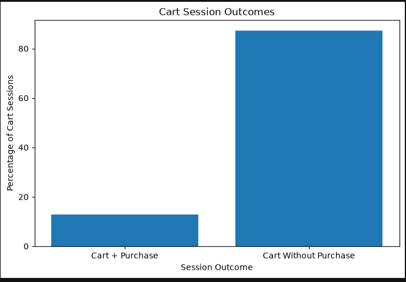
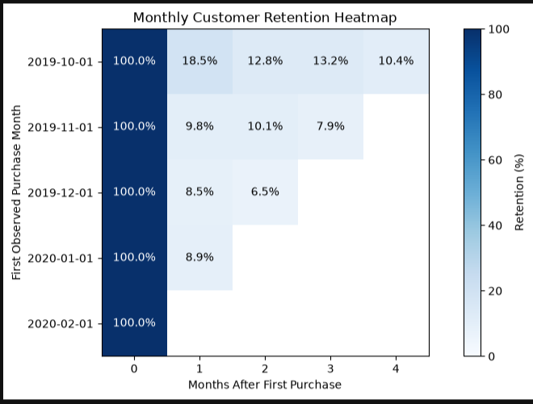
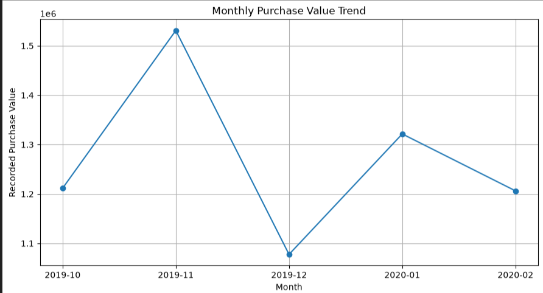
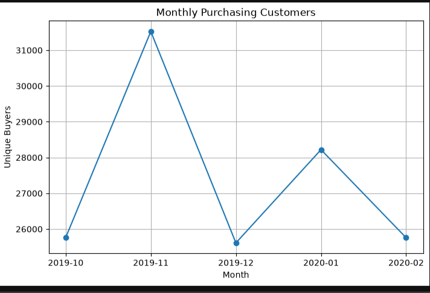
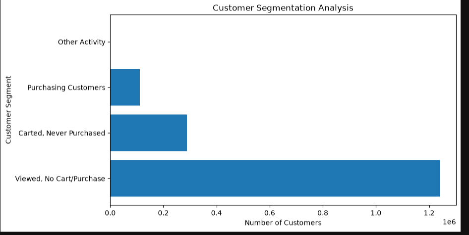

# Customer Growth Analytics

### E-commerce Customer Behaviour, Conversion, Retention & A/B Testing

**Tools:** SQL Server | SSMS | Python | Pandas | Matplotlib | Jupyter Notebook | Microsoft Excel

**Dataset:** REES46 Cosmetics E-commerce Events  
**Analysis Period:** October 2019 – February 2020  
**Records Analysed:** 20,692,840

---

## 1. Project Overview

This project analyses over **20.69 million e-commerce customer activity records** to investigate conversion challenges, customer retention, purchasing trends, and opportunities for sustainable business growth.

The objective was to transform large-scale customer behaviour data into actionable business insights and management recommendations.

The project combines SQL-based analysis, Python visualizations, cohort retention analysis, an Excel Executive Scorecard, and statistical A/B testing using a separate marketing experiment dataset.

## 2. Business Objectives

- Identify customer conversion challenges across shopping activities.
- Analyse cart-session outcomes and potential purchase conversion opportunities.
- Measure repeat purchasing and customer cohort retention.
- Segment customers according to observed purchasing behaviour.
- Evaluate monthly purchasing performance.
- Apply statistical hypothesis testing to marketing experimentation.
- Recommend and prioritize measurable growth initiatives.

## 3. Dataset & Tools

**Primary Dataset:** [E-commerce Events History in Cosmetics Shop — REES46](https://www.kaggle.com/datasets/mkechinov/ecommerce-events-history-in-cosmetics-shop)

The dataset contains 20,692,840 customer activity records across five monthly files, covering October 2019 through February 2020.

**Secondary Dataset:** [Marketing A/B Testing](https://www.kaggle.com/datasets/faviovaz/marketing-ab-testing)

A separate dataset containing 588,101 records was used exclusively for A/B testing. It was not combined with the primary e-commerce dataset.

| Tool | Application |
|---|---|
| SQL Server & SSMS | Data preparation, validation, cleaning, and business analysis |
| Python & Pandas | KPI calculations, customer analysis, and retention |
| Matplotlib | Analytical charts and cohort visualizations |
| Jupyter Notebook | Exploratory analysis and experimentation |
| Microsoft Excel | Interactive Executive Scorecard and management KPIs |

## 4. Analytical Approach

**Data Preparation**

Imported five monthly datasets into SQL Server, validated data types, assessed missing values, identified duplicates, and prepared a combined analytical table while preserving the original raw tables.

**SQL Analysis**

Investigated customer activity, conversion patterns, cart-session outcomes, monthly retention, customer segmentation, and product performance.

**Python Analysis**

Calculated analytical KPIs and developed visualizations for customer behaviour, purchasing trends, retention cohorts, and session conversion.

**A/B Testing**

Applied a two-proportion Z-test to compare observed conversion rates between advertisement and control groups using an independent marketing dataset.

**Excel Reporting**

Developed an Executive Scorecard incorporating PivotTables, Pivot Charts, SUMIFS, VLOOKUP, monthly growth calculations, and interactive month selection.

## 5. Key Business Findings

### Finding 1 — Cart Conversion Opportunity

Of 985,813 sessions containing cart additions, **859,529 sessions (87.19%) had no recorded purchase within the same session**.

This identifies a significant conversion-improvement opportunity. However, session data alone cannot establish why customers did not purchase.

### Finding 2 — Customer Retention

Across the five-month period, 110,518 unique customers made recorded purchases.

Only **17,720 customers (16.03%) purchased across multiple months**, indicating potential opportunities to improve repeat purchasing.

### Finding 3 — Monthly Purchasing Performance

November 2019 recorded the highest purchase value at approximately 1.53 million recorded units.

Recorded purchase value subsequently declined by **29.61% in December**, alongside an **18.8% reduction in unique purchasing customers**.

These figures are provisional because identical event records were retained during data preparation.

### Finding 4 — Customer Segmentation

Behavioural segmentation identified:

- **1,239,279 customers** who viewed products but did not add items to their carts or purchase.
- **288,701 customers** who added products to carts but never purchased.
- **110,518 customers** who made at least one recorded purchase.

These segments offer distinct opportunities for product discovery improvements, conversion experiments, and customer retention initiatives.

## 6. A/B Testing & Statistical Analysis

An independent marketing A/B testing dataset was analysed to evaluate whether advertisement exposure was associated with higher conversion.

| Metric | Control (PSA) | Treatment (Advertisement) |
|---|---:|---:|
| Users | 23,524 | 564,577 |
| Conversions | 420 | 14,423 |
| Conversion rate | 1.79% | 2.55% |

**Statistical Results**

- Absolute conversion lift: **+0.77 percentage points**
- Relative conversion lift: **+43.09%**
- Z-score: **7.37**
- P-value: **Below 0.00001**

The difference in observed conversion rates was statistically significant at the 5% significance level.

**Business Interpretation:** The advertisement group exhibited higher conversion. A controlled expansion could be considered after validating experiment randomization, unequal group allocation, advertising costs, and incremental profitability.

The findings from this independent experiment should not be treated as evidence of advertising effectiveness for the cosmetics business.

## 7. Prioritized Business Recommendations

| Priority | Business opportunity | Recommended actions |
|---|---|---|
| 1 | Improve cart conversion | Test cart recovery reminders and simplified checkout experiences |
| 2 | Increase repeat purchasing | Test personalized recommendations and customer retention campaigns |
| 3 | Investigate monthly performance declines | Examine conversion trends, promotional changes, product availability, and category performance |

Management should evaluate interventions through controlled experiments, measurable KPIs, implementation costs, and potential risks before broader implementation.

**Suggested performance metrics:** Cart-session purchase conversion, repeat-purchase rate, 30-day retention, monthly purchasing customers, and incremental profit.

## 8. Analytical Limitations

- Approximately 1.11 million additional identical event records were identified and retained, potentially inflating recorded purchase values.
- Missing brand and category information limited some product-level analysis.
- The five-month observation window restricts conclusions about longer-term customer behaviour.
- Session-level conversion does not confirm the purchase of every carted product.
- Observational findings do not establish causal relationships.
- The marketing A/B testing dataset was analysed separately and cannot establish advertising effectiveness for the cosmetics business.

## 9. Repository Structure

| Folder | Contents |
|---|---|
| [01_SQL](01_SQL) | Data preparation, conversion, retention, segmentation, and performance analysis |
| [02_Python](02_Python) | Customer Growth Analysis Jupyter notebook |
| [03_AB_Testing](03_AB_Testing) | Statistical marketing experiment notebook |
| [04_Excel](04_Excel) | Executive Scorecard and monthly performance data |
| [05_Management_Report](05_Management_Report) | Management Decision Report |
| [06_Documentation](06_Documentation) | Technical Project Documentation |
| [07_Visualizations](07_Visualizations) | Five analytical visualizations |

Raw datasets and database backups are excluded from this repository.

## 10. Conclusion

This project demonstrates how SQL, Python, statistical experimentation, and Excel can be combined to analyse large-scale customer behaviour and support evidence-based management decisions.

The analysis identifies opportunities to improve cart conversion, encourage repeat purchasing, and investigate changes in monthly performance.

The recommended approach emphasizes **prioritized business actions, controlled experimentation, and measurable growth outcomes** rather than implementing untested changes.

---

**Author:** [Ekansh Mathur](https://github.com/ekanshmathur)
